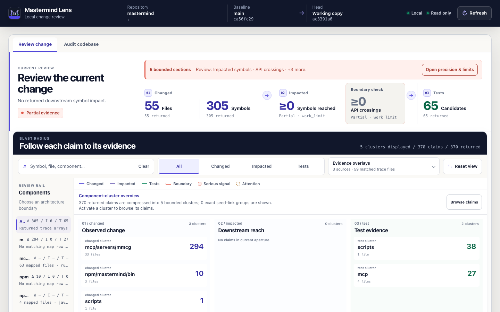

<p align="center">
  
</p>

<h1 align="center">Mastermind</h1>

<p align="center">Repository context and evidence-backed workflows for coding agents.</p>

<p align="center">
  <a href="https://www.npmjs.com/package/@xcraftmind/mastermind"></a>
  <a href="https://github.com/xcrft/mastermind/actions/workflows/ci-mmcg.yml"></a>
  <a href="LICENSE"></a>
</p>

Mastermind indexes your code and documentation locally, gives coding agents
that context over MCP and prompt hooks, and checks a task's evidence before the
task counts as done. `init` sets up Claude Code and Codex, and any client that
can launch a stdio MCP server can connect too.

## Quick start

You need Node.js 24 or later. The npm package ships prebuilt binaries for macOS,
Linux and Windows. Run this inside your repository, then restart the client:

```bash
npm install -g @xcraftmind/mastermind
mastermind init
mastermind status --json
```

`init` sets up the clients it finds, indexes the repository and saves its
choices in `.mastermind/setup.json`, and `status` shows the index, the client
configuration and the sessions Mastermind has seen.

<p align="center">
  
</p>

## What you can do

| Goal | Start with |
|---|---|
| Install, pick clients, update or remove | [Getting started](docs/getting-started.md) |
| Review a change | `mastermind impact --since main`, or `mastermind ui --since main` for Lens, the local read-only review UI ([Lens reference](docs/reference/lens.md)) |
| Delegate a task and check the result | `mastermind new-spec "Add account recovery"`, then the [workflow guide](docs/workflow.md) |
| Apply your working preferences | [Persona hooks](docs/guides/persona-hooks.md) |
| Connect Cursor, Continue or another MCP client | [Other MCP clients](docs/integrations/generic-mcp.md) |
| Pick the reasoning effort for a new agent | [Effort routing](docs/guides/effort-routing.md) |
| Import SCIP, SARIF, coverage, JUnit or OTLP data | [Fact ingestion](docs/fact-ingestion-sdk.md) |
| Query several local repositories | [Team graph](docs/team-graph.md) |
| Publish verified audit results from CI | [GitHub audit Action](docs/github-action.md) |
| Look up a CLI command or index rule | [CLI and index](docs/reference/mmcg.md) |
| Look up an MCP tool | [MCP](docs/reference/mcp.md) |
| Search symbols by plain concept terms | [Concept search](docs/reference/concept-search.md) |
| Check architecture rules over a change | [Policy as code](docs/reference/policy.md) |
| Look up spec fields, report rules or the CI gate | [Specs, reports and CI](docs/reference/spec-and-report.md) |
| Look up checks, receipts, native execution and repair | [Task runtime](docs/reference/task-runtime.md) |
| Look up profile storage, access and review | [Persona](docs/reference/persona.md), [context packets](docs/reference/persona.md#context-packets), [persona evidence](docs/reference/persona-evidence.md) |
| Copy a workflow or client configuration | [Examples](docs/examples/) |
| See measured results and known gaps | [Scorecard](evals/scorecard.md) |
| Build, test or release Mastermind | [Contributing](CONTRIBUTING.md) |
| Report a vulnerability | [Security policy](SECURITY.md) |

## How it works

Mastermind supplies project evidence, your reviewed preferences and a task
controller. The client supplies the model and the tool runtime. Each selected
client gets your reviewed habits from `~/.mastermind/`, the project's
`CONTEXT.md`, lessons and indexed sources, the installed role and workflow
instructions, and the task records in `.mastermind/tasks/`.

Preferences guide the agent but grant no tool permission and change no
acceptance criteria. A client reads your profile only for the projects you
selected, and `mastermind init --profile-access off` turns that off. A task
completes only when its checks, audit and review all match the current files.

## Limits

| Area | Limit |
|---|---|
| Codegraph | Static. Dynamic dispatch, reflection, generated code and cross-language calls can be missing. [Language coverage](docs/reference/mmcg.md#language-coverage) includes Python, TypeScript and TSX, JavaScript and JSX, Vue SFC, Rust, C#, Go, Java, PHP and C/C++ |
| Task records | Local and owner-writable. They record what ran and leave correctness to the review. External dependencies and network responses are not part of the check binding |
| Native execution | Uses the client's permission rules and a postflight scope audit. There is no OS sandbox. `mastermind doctor` reports client settings, repository skills, subagents, MCP servers and hooks that let code run or secrets leave without asking, and fails on the worst of them, see [permission rules](docs/reference/mmcg.md#permission-rules) and [client hooks](docs/reference/mmcg.md#client-hooks). It cannot prove a narrow rule safe |
| Task mining | Uses the current agent's allowance for the extra context and tool calls. Drafts need your review |
| Separate model requests | Background mining, refinement, drafting, execution and review each need their own option, see [provider contracts](docs/reference/persona.md#hook-processor-contract) |
| Windows | Local indexing and client setup with `--mining off`. Native hooks, managed mining and supervised execution need macOS or Linux, see [process supervision](docs/reference/task-runtime.md#process-supervision) |

## Build from source

You need Rust 1.96 or later, as declared in
[Cargo.toml](mcp/servers/mmcg/Cargo.toml). Cargo installs only `mmcg`, without
the npm workflow bundle. Bugs and questions go to
[GitHub Issues](https://github.com/xcrft/mastermind/issues), and changes in
each release to the [changelog](CHANGELOG.md).

```bash
cargo install --path mcp/servers/mmcg --locked
just check
```

## License

[MIT](LICENSE).
