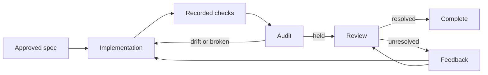

# Take a task from spec to completion

This guide walks one task through Mastermind: write and approve a spec, implement
it, record the checks, audit the diff, review the result and close the task.
Small changes can skip all of that and use direct mode. The exact limits and
rules behind each step are in [task runtime](reference/task-runtime.md) and
[specs, reports and CI](reference/spec-and-report.md).

`mastermind run-task` is the controller. It keeps the task state in
`<task>/state.json` and decides when each step may happen. A receipt is a JSON
file a command writes to record what ran, with which inputs and result.



## Choose a mode

| Mode | Use for | What you do |
|---|---|---|
| Direct | Small reversible changes | Implement and run the checks the repository needs |
| Verified | An explicit contract or delegated execution | Spec, preflight, checks, audit, review |
| Strict | High impact or a hard rollback | Verified plus risk, alternatives, rollback and an independent review |

## Direct

```bash
mastermind index .
mastermind impact --since main
```

Implement, run the relevant checks and review the diff. Direct work creates no
task state.

## Verified

Run every command from the repository root.

### 1. Write and approve the spec

```bash
mastermind new-spec "Add account recovery"
```

The command prints the new spec path. The examples below use:

```bash
TASK_SPEC=.mastermind/tasks/001-add-account-recovery/spec.md
```

| Spec part | What goes in |
|---|---|
| Goal | The behavior you can observe when the task is done |
| Scope | Files and symbols the executor may change |
| Acceptance | Criteria, each mapped to checks |
| Verification | Commands and their expected outcome |
| Product or design context | Sources the reviewer can open |

The [spec frontmatter reference](reference/spec-and-report.md#spec-frontmatter)
lists every field. Map each acceptance criterion to the checks that prove it:

```yaml
verify:
  - cmd: python3 -m unittest discover -s tests
    run:
      id: unit
      argv: [python3, -m, unittest, discover, -s, tests]
      cwd: .
      timeout_secs: 300
acceptance:
  - id: expired-token
    statement: An expired recovery token is rejected without changing the account.
    checks: [unit]
```

Replace the example with your project's checks. Every mapped check is required,
and the reviewer later judges whether its assertions support the criterion.

Check the spec and approve it:

```bash
mastermind verify-spec "$TASK_SPEC"
mastermind run-task "$TASK_SPEC" --pre-only
```

Preflight binds the spec, the Git baseline and the iteration number. If the
checkout already has local changes, the first approval records them, and later
audits leave them out unless the task changes them again. A spec edit needs
another `--pre-only` run, and retries keep the original baseline. The rules are
in [revise an approved task](reference/task-runtime.md#revise-an-approved-task).

Keep one open task per checkout. Postflight audits every change made after the
first approval, so another task's edits show up as `unexpected_file` findings,
the verdict becomes Broken and this task's receipts go stale. Close a task
before you approve the next one in the same checkout.

### 2. Implement and record the checks

Give the approved spec to an implementation client. The executor writes its
report to the path `run-task --pre-only` printed, with changed files, observed
results, defects and gaps. For `<task>/spec.md` that is
`<task>/executor-report.md`. For UI work, the report includes browser
observations or says why there are none.

Record each observed check after the implementation is done:

```bash
mastermind verification run "$TASK_SPEC" --id unit --json
mastermind acceptance status "$TASK_SPEC" --json
```

`verification run` executes the declared argv, without a shell, and writes
`<task>/verification/unit.json`. The receipt is bound to the task, the files,
the Git state and the executable, so any later edit, staging or commit makes it
stale. A check declared with only `cmd` and no `run` is a reported result, not
an observed one. Put task-specific check scripts in `<task>/verify/`, which the
runner binds even when the folder is ignored. Runs need macOS or Linux, and
they have your normal file system and network access. The limits are in
[observed verification](reference/task-runtime.md#observed-verification).

### 3. Audit the implementation

```bash
mastermind run-task "$TASK_SPEC" --post-only
```

Postflight compares the spec, the executor report, the receipts and the actual
diff, including staged, unstaged and untracked work. It doesn't run any checks.

| Verdict | Meaning | What to do |
|---|---|---|
| Held | The diff, report and receipts match the approved contract | Review the result and project knowledge |
| `history_review_required` | Held, and project knowledge still needs a decision | Same as Held |
| Drift | The change goes outside the approved scope | Fix the scope difference or revise the spec |
| Broken | Evidence is missing or inconsistent | Repair it and audit again |

## Review and complete

### Prepare and submit an assessment

```bash
mastermind review-task prepare "$TASK_SPEC" --json
```

The output has the evidence and an empty `draft`. A person or an LLM reviewer
fills in the draft after reading the evidence:

| Assessment | Question |
|---|---|
| Each criterion | Does the implementation satisfy the statement? |
| Verification quality | Do the assertions test that behavior? |
| Scope control | Do the changes stay inside the approved contract? |
| Proportionality | Is the solution the right size for the task? |

Give concrete reasons and evidence references, and leave a judgment `unknown`
when the evidence doesn't support it. Save the draft as JSON inside the
repository and submit it:

```bash
mastermind review-task submit "$TASK_SPEC" \
  --report .mastermind/tasks/001-add-account-recovery/review-input.json --json
mastermind review-task status "$TASK_SPEC" --json
```

These commands don't call a model. A new negative or unknown assessment replaces
an earlier approval. Submission errors are listed in
[semantic task review](reference/spec-and-report.md#semantic-task-review).

### Decide on project knowledge

The draft also asks whether `CONTEXT.md` and `.mastermind/tasks/_lessons.md`
need an update. Decide each one on its own:

| Decision | Meaning | Completion |
|---|---|---|
| `no_change` | The current file needs no further update | Allowed |
| `update_required` | A durable decision or lesson still has to be written | Blocked |
| `unknown` | More inspection is needed | Blocked |

Completion needs `no_change` for both, each citing its own `knowledge:context`
or `knowledge:lessons` reference. If you already wrote the update, the decision
is `no_change`.

| Change after the review | Follow-up |
|---|---|
| `CONTEXT.md` or `_lessons.md` | A fresh review |
| Tracked inputs or a check executable | Fresh checks and audit |
| Only the ignored `_lessons.md` | A fresh review, with no new checks |

A standalone submit or native review can exit 0 with `status: accepted` while
the knowledge decisions are still open. That record doesn't complete the task.

### Close the task

```bash
mastermind run-task "$TASK_SPEC"
```

The controller checks the receipts, executables, audit and review once more and
then marks the task `learned`, the completed state. `learned` records the
reviewed iteration, not a deployment. Resume, auto-review and a repeated
postflight go through the same final check.

Commit after `learned`. The receipts bind HEAD and the Git index, so a commit or
a staged change while the task is open makes them stale
(`receipt_snapshot_changed`), and the checks, audit and review have to run
again.

## Continue from feedback

```bash
mastermind review-task follow-up "$TASK_SPEC" --json
```

The packet is read-only and names the first unresolved item and what to do
about it. `mastermind next` and `mastermind resume` send an unresolved review
here too.

| First unresolved item | Action | Who |
|---|---|---|
| Unsatisfied assessment | `revise_solution` | Planner |
| Unknown assessment | `inspect_review` | Reviewer |
| Knowledge update required | `update_project_history` | Planner |
| Unknown knowledge decision | `inspect_project_history` | Reviewer |
| Everything resolved | `complete` | Controller |

After the fix, changed check inputs need new checks, changed audit inputs need
postflight, and new knowledge needs a review. A scope change needs a revised
spec and a new `--pre-only` approval, because review reasons never widen scope.

## Run the executor and reviewer natively

`--exec` runs Claude Code as the executor, with the task context on stdin, and
records the run in `<task>/invocation.json`. Other clients use the handoff
above.

```bash
mastermind run-task "$TASK_SPEC" --exec --exec-timeout 1800 --exec-max-turns 40
```

Each run is a new preflight iteration with the original baseline. The executor
gets edit permissions without prompts and without a blanket Bash grant, and it
inherits your Claude Code authentication, MCP servers, hooks and rules. File
scope is still audited afterwards, because native permissions are not an OS
sandbox. The receipt records that the context was offered, but it can't show
what the model read. Defaults, limits and the policy are in
[native executor](reference/task-runtime.md#native-executor).

For a task with explicit file scope and observed checks, guarded mode lets the
executor touch only the declared files and run only the declared checks:

```bash
mastermind run-task "$TASK_SPEC" --exec --guarded-exec --auto-review
```

A failed native hook can fall back to client permissions, so guarded mode
mediates tool calls but doesn't contain the process. See
[guarded execution](reference/task-runtime.md#guarded-execution).

### Native review

```bash
mastermind review-task run "$TASK_SPEC" --timeout 600 --max-turns 30 --json
```

The reviewer gets read-only tools, no MCP servers and no personal profile, and
answers in a closed JSON schema. It needs Claude Code 2.1.290 or later. The run
is recorded in `review-invocation.json`.

| Command | Runs | Result |
|---|---|---|
| `review-task run` | The reviewer only | Stores the assessment |
| `run-task --exec --auto-review` | Executor, audit, then one review | Closes the task if every gate passes |
| `run-task --auto-review` | One review of an existing held task | Keeps the baseline, iteration and executor receipt |
| `run-task --exec --auto-review --auto-follow-up` | Also one repair of unmet criteria and a fresh review | Uses the same iteration budget |

A negative review stops the run unless `--auto-follow-up` applies. An unknown
judgment, open knowledge decisions or a native failure always stop it. Limits
and project defaults are in
[native semantic reviewer](reference/task-runtime.md#native-semantic-reviewer).

### Bounded automatic repair

```bash
mastermind run-task "$TASK_SPEC" --exec --auto-repair --max-iterations 3 --auto-review
mastermind run-task "$TASK_SPEC" --exec --auto-review --auto-follow-up --max-iterations 3
```

| Situation | What happens |
|---|---|
| A fresh ordinary check failure inside the approved scope, with an honest partial report | `--auto-repair` retries within the iteration budget |
| Missing or stale evidence, an infrastructure failure, scope drift, a runtime denial or a changed executable | Stop |
| A native review with a concrete unmet criterion, every other judgment satisfied and both knowledge decisions `no_change` | `--auto-follow-up` retries once, then runs fresh checks, audit and review |
| An unknown judgment, open knowledge decisions, a scope or permission problem, stale sources | Stop without a repair |

Both modes need structured acceptance and observed checks. The iteration budget
counts every earlier preflight and is 1-20. The exact gates are in
[automatic repair](reference/task-runtime.md#automatic-repair) and
[one semantic follow-up](reference/task-runtime.md#one-semantic-follow-up).

## Strict

```bash
mastermind new-spec "Rotate signing keys" --mode strict
```

Add alternatives, threat and failure cases, a rollback or migration plan, and an
independent review. Changes to auth, secrets, permissions, delegation and the
supply chain get a security review. `mode: strict` turns on the strict
preflight checks.

## Task files

| File | Written by | Holds |
|---|---|---|
| `spec.md` | Planner | Goal, scope, criteria, checks, risk |
| `executor-report.md` | Executor | Observations and gaps |
| `verification/*.json` | Check runner | Latest check results |
| `audit.md`, `state.json` | Controller | Audit findings and task state |
| `invocation.json` | Executor runner | Native execution record |
| `review-invocation.json` | Reviewer runner | Native review record |
| `semantic-review.json` | Review commands | Judgments and the active revision |
| `history-review.md` | Controller | Pointer to the knowledge decisions |
| `preflight-approvals/`, `preflight-inputs/` | Controller | Retained approvals and the initial-worktree copies. Keep them with the task |

Project knowledge belongs in `CONTEXT.md` and the reviewed lessons. Personal
habits belong in your [profile](guides/persona-hooks.md).

These files are local and unsigned, and anyone with write access to the
checkout can change them.

## When progress stops

| Problem | What to do |
|---|---|
| Index missing or stale | `mastermind index .`, then `mastermind status` |
| Spec changed | `mastermind run-task "$TASK_SPEC" --pre-only` to approve the revision |
| Check missing, failed or stale | Run it again on the final inputs, then `--post-only` |
| Review target changed | Prepare a fresh assessment |
| Knowledge update required | Write the update, then review again |
| Native run failed | Read the reason in the receipt and fix the blocker |
| Controller busy | Wait for the other controller on that task to finish |
| Evidence malformed or missing | Restore it or run the step that writes it |

## Check the workflow installation

```bash
mastermind workflow audit --root .
mastermind doctor --workflow --client all
```

Both check installation and wiring without running an agent.
`doctor --workflow` comes from the npm package, so a `mastermind` built with
cargo doesn't have it. The diagnostics are in
[workflow audit](reference/mmcg.md#workflow-audit).
