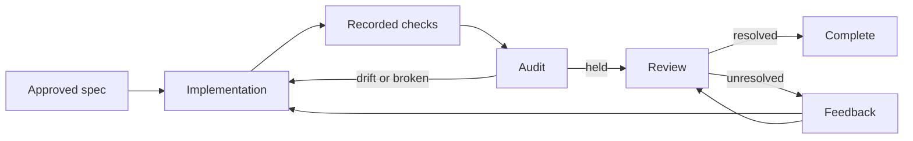

# Take a task from spec to completion

This guide takes one task through Mastermind: you write and approve a spec,
implement it, record the checks, audit the diff, review the result and close
the task. Small changes skip all of that. The exact rules behind each step are
in [task runtime](reference/task-runtime.md) and
[specs, reports and CI](reference/spec-and-report.md).

`mastermind run-task` is the controller. It keeps the task state in
`<task>/state.json` and decides when each step may happen. A receipt is the JSON
record a command writes of what ran, with which inputs and result.



## Choose a mode

| Mode | Use for | What you do |
|---|---|---|
| Direct | Small reversible changes | Run `mastermind impact --since main`, implement, run the checks the repository needs. No task state |
| Verified | An explicit contract or delegated execution | The steps below |
| Strict | High impact or a hard rollback | `mastermind new-spec "<title>" --mode strict`, then the steps below with alternatives, threat and failure cases, a rollback plan and an independent review. Auth, secrets, permissions, delegation and supply chain changes also get a security review |

## Verified task

Run every command from the repository root. Keep one open task per checkout,
because postflight audits every change made after the first approval. Another
task's edits show up as `unexpected_file` findings and break this task.

1. Create the spec:

   ```bash
   mastermind new-spec "Add account recovery"
   TASK_SPEC=.mastermind/tasks/001-add-account-recovery/spec.md
   ```

   Fill in the goal, the scope the executor may change, the acceptance
   criteria and the checks, and map each criterion to the checks that prove it.
   Every mapped check is required:

   ```yaml
   verify:
     - cmd: python3 -m unittest discover -s tests
       run:
         id: unit
         argv: [python3, -m, unittest, discover, -s, tests]
         cwd: .
         timeout_secs: 300
   acceptance:
     - id: expired-token
       statement: An expired recovery token is rejected without changing the account.
       checks: [unit]
   ```

   The [spec frontmatter reference](reference/spec-and-report.md#spec-frontmatter)
   lists every field.

2. Check and approve the spec:

   ```bash
   mastermind verify-spec "$TASK_SPEC"
   mastermind run-task "$TASK_SPEC" --pre-only
   ```

   Preflight binds the spec, the Git baseline and the iteration number, and
   prints the path for the executor report. Local changes that already exist
   are recorded, and later audits leave them out unless the task changes them
   again. A spec edit needs another `--pre-only` run, see
   [revise an approved task](reference/task-runtime.md#revise-an-approved-task).

3. Give the approved spec to an implementation client. The executor writes
   `<task>/executor-report.md` with changed files, observed results, defects
   and gaps. For UI work, the report includes browser observations or says why
   there are none.

4. Record each check after the implementation is done:

   ```bash
   mastermind verification run "$TASK_SPEC" --id unit --json
   mastermind acceptance status "$TASK_SPEC" --json
   ```

   `verification run` executes the declared `argv` without a shell and writes
   `<task>/verification/unit.json`. The receipt binds the task, the files, the
   Git state and the executable, so any later edit, staging or commit makes it
   stale. A check with only `cmd` and no `run` counts as a reported result, not
   an observed one. Task-specific check scripts go in `<task>/verify/`. Runs
   need macOS or Linux and have your normal file system and network access, see
   [observed verification](reference/task-runtime.md#observed-verification).

5. Audit the implementation:

   ```bash
   mastermind run-task "$TASK_SPEC" --post-only
   ```

   Postflight compares the spec, the executor report, the receipts and the
   actual diff, including staged, unstaged and untracked work. It runs no
   checks.

   | Verdict | Meaning | What to do |
   |---|---|---|
   | Held | The diff, report and receipts match the approved contract | Review the result |
   | `history_review_required` | Held, and project knowledge still needs a decision | Review the result |
   | Drift | The change goes outside the approved scope | Fix the scope difference or revise the spec |
   | Broken | Evidence is missing or inconsistent | Repair it and audit again |

## Review and complete

1. Prepare the review packet:

   ```bash
   mastermind review-task prepare "$TASK_SPEC" --json
   ```

   A person or an LLM reviewer fills in the empty `draft` from the evidence:
   does each criterion hold, do the assertions test that behavior, does the
   change stay in scope, and is the solution the right size. Cite evidence for
   each reason, and leave a judgment `unknown` when the evidence doesn't
   support it.

2. Decide on project knowledge in the same draft. `CONTEXT.md` and
   `.mastermind/tasks/_lessons.md` each get one decision:

   | Decision | Meaning | Completion |
   |---|---|---|
   | `no_change` | The file needs no further update, or you already wrote it | Allowed |
   | `update_required` | A durable decision or lesson still has to be written | Blocked |
   | `unknown` | More inspection is needed | Blocked |

   Completion needs `no_change` for both, each citing its own
   `knowledge:context` or `knowledge:lessons` reference.

3. Save the draft as JSON inside the repository and submit it:

   ```bash
   mastermind review-task submit "$TASK_SPEC" \
     --report .mastermind/tasks/001-add-account-recovery/review-input.json --json
   mastermind review-task status "$TASK_SPEC" --json
   ```

   These commands call no model. A new negative or unknown assessment replaces
   an earlier approval. A submit can exit 0 with `status: accepted` while the
   knowledge decisions are still open, and that doesn't complete the task.
   Submission errors are in
   [semantic task review](reference/spec-and-report.md#semantic-task-review).

4. Close the task:

   ```bash
   mastermind run-task "$TASK_SPEC"
   ```

   The controller checks the receipts, executables, audit and review once more,
   then marks the task `learned`, the completed state. `learned` records the
   reviewed iteration, not a deployment. Resume, auto-review and a repeated
   postflight go through the same final check.

5. Commit after `learned`. The receipts bind HEAD and the Git index, so a commit
   or a staged change while the task is open makes them stale
   (`receipt_snapshot_changed`), and the checks, audit and review run again.

## Continue from feedback

```bash
mastermind review-task follow-up "$TASK_SPEC" --json
```

The packet is read-only and names the first unresolved item. `mastermind next`
and `mastermind resume` send an unresolved review here too.

| First unresolved item | Action | Who |
|---|---|---|
| Unsatisfied assessment | `revise_solution` | Planner |
| Unknown assessment | `inspect_review` | Reviewer |
| Knowledge update required | `update_project_history` | Planner |
| Unknown knowledge decision | `inspect_project_history` | Reviewer |
| Everything resolved | `complete` | Controller |

## Run the executor and reviewer natively

Native execution and review launch Claude Code, even when another client did
the planning or the implementation. Other clients use the handoff above.

| Command | What it runs |
|---|---|
| `mastermind run-task "$TASK_SPEC" --exec --exec-timeout 1800 --exec-max-turns 40` | Claude Code as the executor, as a new preflight iteration with the original baseline. Recorded in `<task>/invocation.json` |
| `mastermind run-task "$TASK_SPEC" --exec --guarded-exec --auto-review` | The executor limited to the declared files and checks, then audit and one review |
| `mastermind review-task run "$TASK_SPEC" --timeout 600 --max-turns 30 --json` | The reviewer only. Recorded in `review-invocation.json` |
| `mastermind run-task "$TASK_SPEC" --auto-review` | One review of an existing held task |
| `mastermind run-task "$TASK_SPEC" --exec --auto-repair --max-iterations 3 --auto-review` | Retries a fresh ordinary check failure inside the approved scope |
| `mastermind run-task "$TASK_SPEC" --exec --auto-review --auto-follow-up --max-iterations 3` | One repair of a concrete unmet criterion, then fresh checks, audit and review |

The executor gets edit permissions without prompts and without a blanket Bash
grant, and it inherits your Claude Code authentication, MCP servers, hooks and
rules. Native permissions are not an OS sandbox, so file scope is still audited
afterwards, and guarded mode mediates tool calls without containing the process
because a failed native hook can fall back to client permissions. The reviewer
gets read-only tools, no MCP servers and no personal profile, answers in a
closed JSON schema and needs Claude Code 2.1.290 or later.

A negative review stops the run unless `--auto-follow-up` applies.
Auto-repair and auto-follow-up need structured acceptance and observed checks.
The iteration budget counts every earlier preflight and is 1-20. Missing or
stale evidence, an infrastructure failure, scope drift, a runtime denial, a
changed executable, an unknown judgment or open knowledge decisions stop the
run without a repair. The limits are in
[native executor](reference/task-runtime.md#native-executor),
[guarded execution](reference/task-runtime.md#guarded-execution),
[native semantic reviewer](reference/task-runtime.md#native-semantic-reviewer),
[automatic repair](reference/task-runtime.md#automatic-repair) and
[one semantic follow-up](reference/task-runtime.md#one-semantic-follow-up).

## Task files

| File | Written by | Holds |
|---|---|---|
| `spec.md` | Planner | Goal, scope, criteria, checks, risk |
| `executor-report.md` | Executor | Observations and gaps |
| `verification/*.json` | Check runner | Latest check results |
| `audit.md`, `state.json` | Controller | Audit findings and task state |
| `invocation.json`, `review-invocation.json` | Native runners | Native execution and review records |
| `semantic-review.json` | Review commands | Judgments and the active revision |
| `history-review.md` | Controller | Pointer to the knowledge decisions |
| `preflight-approvals/`, `preflight-inputs/` | Controller | Retained approvals and the initial-worktree copies. Keep them with the task |

These files are local and unsigned, and anyone with write access to the
checkout can change them.

## When progress stops

| Problem | What to do |
|---|---|
| Index missing or stale | `mastermind index .`, then `mastermind status` |
| Spec changed | `mastermind run-task "$TASK_SPEC" --pre-only` to approve the revision |
| Check missing, failed or stale | Run it again on the final inputs, then `--post-only` |
| Review target changed, including `CONTEXT.md` or `_lessons.md` | Prepare a fresh assessment |
| Tracked inputs or a check executable changed after the review | Fresh checks, then `--post-only` and a fresh review |
| Scope has to grow | Revise the spec and approve it again with `--pre-only`. Review reasons never widen scope |
| Knowledge update required | Write the update, then review again |
| Native run failed | Read the reason in the receipt and fix the blocker |
| Controller busy | Wait for the other controller on that task to finish |
| Evidence malformed or missing | Restore it or run the step that writes it |
| Workflow skills or agents look wrong | `mastermind workflow audit --root .` and `mastermind doctor --workflow --client all`, see [workflow audit](reference/mmcg.md#workflow-audit) |
