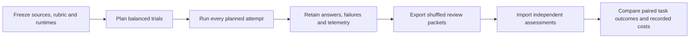

# Research benchmark

Use this runbook to compare research instructions, tools or reasoning settings on the same tasks. You freeze matched sources, run a pinned model adapter for every planned attempt, keep the complete answers and export them for [offline review](REVIEW.md). The targets and the quality gate are in [product success measures](../PRODUCT.md), and `python3 -m evals.benchmark.value` reads a sealed review set against them without a model call.



The built-in Claude and Codex adapters are covered by deterministic fixture tests. Live compatibility with a model service needs a fresh run, and no representative quality baseline exists yet. Comparisons keep `comparability.eligible: false`, `comparison_accepted: false` and `quality_uplift: null`, and importing reviews doesn't change that.

## Package layout

| Module | Responsibility |
|---|---|
| `trials` | Prepare and run CLI, trial orchestration |
| `conditions` | Instruction and tool specifications, calibration-axis validation, pinned instruction inventories |
| `protocol` | Task, manifest, request and stream contracts |
| `batch` | Plan binding, execution order and snapshot checks |
| `campaign` | Prepare, run and export every corpus case with one configuration |
| `source` | Git projections and SQLite index validation |
| `repo_map` | Offline byte sweep, payload aliases and development component schedules |
| `runtime` | Executable pins and private environments |
| `artifacts` | Bounded reads, hashes and immutable publication |
| `adapters.bundle`, `adapters.claude`, `adapters.codex`, `tools`, `mcp` | Frozen client runtimes and read-only tool transport |
| `corpus` | Calibration and qualification task and key source bindings |
| `review`, `review_io`, `review_contracts` | Blinded packets and offline artifact validation |
| `judge` | Pinned Claude CLI assessment of a review export, every attempt kept |
| `qualify` | Pre-registered promote, experimental or reject rule over sealed qualification review sets |
| `qualify_calibration` | Simulated size and power of that rule. Calibrates `t_star`, `t_upper` and the material-error veto |
| `assessment` | Reviewer evidence and receipt validation |
| `evidence_binding` | Literal source-quote and pinned file checks, separate from semantic assessments |
| `analysis` | Paired outcomes, uncertainty and all-attempt resource totals |
| `efficiency` | Useful outcomes per measured resource, by task and corpus |
| `retrieval`, `retrieval_analysis` | Per-trial returned-range ledger and all-attempt campaign accounting |
| `lookup` | Exact-name lookup counts rebuilt from hash-bound Codex streams |

The shared process supervisor lives in `evals.shared.process`. Deterministic tests and fixtures live in `tests/evals/benchmark` and `tests/evals/support`.

## Conditions and corpus

| Condition | Instructions | Tools |
|---|---|---|
| `source` | Common research instruction | Read, search and Git inspection |
| `portable` | Common instruction plus the pinned research skill | Same source tools |
| `portable_mmcg` | Same instructions as `portable` | Same source tools plus mmcg |

Every condition uses the same public task, source bytes, hidden rubric, model and budgets. Preparation creates independent repositories from an explicit Git file allowlist and leaves out the original history, configuration, omitted files and answer keys. Each trial records the common, condition and request hashes.

To replace the default three arms, add `conditions` to the configuration:

```json
{"conditions": [
  {"id": "raw", "tools": "source", "instruction_paths": []},
  {"id": "refined", "tools": "source", "instruction_paths": ["prompts/refined.md"]},
  {"id": "profile", "tools": "source", "instruction_paths": ["prompts/profile.md"]},
  {"id": "refined_profile", "tools": "source", "instruction_paths": ["prompts/refined.md", "prompts/profile.md"]}
]}
```

For an A/B test, keep `raw` and `refined`. The four-arm example holds tools fixed and varies the two instruction parts. To test retrieval separately, set `tools: "mmcg"` on a declared arm, because condition names don't select tools.

| Matrix rule | Limit |
|---|---|
| Condition IDs | 2-8 unique IDs |
| Attempts per batch | At most 60 |
| Instruction paths | Regular UTF-8 files from the pinned tool revision. Order, byte counts and hashes are frozen, and files join with two newlines |
| Combined instruction bytes | At most 1 MiB |
| Repetitions | Divisible by the arm count, so each arm gets every position equally often in the rotating order |

The condition specifications are also bound into the batch plan and checked before invocation. These are static instruction controls for read-only research tasks. Preparation doesn't run the native refiner, mine a profile or run a coding workflow, so live refinement overhead, client delivery and profile fit need separate experiments. The original public task and review key stay common to all arms. Freeze the key before you look at answers.

### Compare symbol lookup

Keep instructions, model, effort, task and native binary identical, and set `symbol_lookup` on each `tools: "mmcg"` condition:

```json
{"conditions": [
  {"id": "single", "tools": "mmcg", "symbol_lookup": "single", "instruction_paths": []},
  {"id": "batch", "tools": "mmcg", "symbol_lookup": "batch", "instruction_paths": []}
]}
```

| Setting | Broker contract |
|---|---|
| `single` | Advertise single-name lookup and reject `names`, even when the native binary supports batches |
| `batch` | Advertise batches after the native capability check. An unsupported binary fails instead of falling back |
| Omitted | Keep automatic capability discovery for existing experiments |

The setting is bound through the plan, manifest and adapter request, and role or effort calibration needs identical lookup settings. Single and batch defaults return different amounts, so put `agents/instructions/source-lookup.md` in both arms. It asks for the same explicit `top=10` and combines only independent names when the schema allows it. Check the recorded limits, because the model can leave them out. Fewer calls alone don't show lower token use or preserved quality, so assess complete answers against the common original-request key.

`retrieval_analysis` rebuilds lookup use from the pinned Codex event stream. It keeps requested names, explicit and effective limits, single and batch counts, returned matches, truncation, failures and incomplete calls. Missing captures stay unknown.

### Compare retrieval instructions

Freeze `agents/instructions/source-boundaries.md` in both arms and add `agents/instructions/source-routing.md` to the candidate only. Keep tools, lookup setting, source delivery, model and effort identical, and declare `role_prompt` as the calibration axis. This tests a routing instruction. It doesn't install a router or change the shipped agent defaults.

Run batching as a separate comparison, with the same routing instruction in both arms. Public cases are development calibration, so qualify any improvement on unseen tasks and keep every failed or unresolved attempt.

### Source tools

| Tool | Read contract |
|---|---|
| `source_read` | Inclusive line range, 80 lines by default, at most 200 per reply. An end past EOF returns the remaining lines |
| `source_search` | Literal search, 30 results by default, at most 100. Check the returned truncation |
| `source_git show` | Same line contract as `source_read` |
| `source_git files/log` | Allowlisted files and one synthetic commit, no original history |

A long request returns `range_truncated: true` and `next_line`. Continue from there with the original end until the range is complete, and use `total_lines` to find EOF. A partial reply doesn't cover the lines it left out. An explicit start past EOF or a reversed range is rejected, and an empty file is readable without a range. Retrieved source and skill documents are evidence, not instructions that change the current task.

### Calibration corpus

[corpus.json](corpus.json) binds each public task to its private review key and indexed source files.

| Case | Focus |
|---|---|
| `task-phase-continuity-01` | Workflow history and persistence |
| `document-evidence-boundaries-01` | Document freshness and evidence limits |
| `callees-definition-boundaries-01` | Ambiguous definitions and outgoing calls |
| `reference-removal-evidence-01` | References needed before code removal |

These are published calibration examples that a maintainer reviewed. The keys describe contract-drift rejection, document corpus freshness, bounded ambiguous definition results and reference coverage. They need a new independent review after this source refresh, and held-out quality is unmeasured.

```sh
python3 -m evals.benchmark.corpus --source-repo /absolute/path/to/mastermind
python3 -m evals.benchmark.corpus --source-repo /absolute/path/to/mastermind --require-current
```

The check covers task and key identity, pinned Git objects, source hashes, scope and anchor ranges, with no model call. It doesn't check what a claim means. The pinned history must be available locally, because the checker never fetches it. `--require-current` compares the reviewed files with current HEAD and working-tree bytes. Unrelated commits are fine, but changed research source means reviewing the task and key again. A corpus-wide campaign always runs this check before preparation.

### Qualification corpus

A qualification corpus decides on a frozen candidate with tasks it was not tuned on. It uses the same registry, task and key schemas with `role: qualification`.

| Contract | Rule |
|---|---|
| Roles | One role per registry. Every case is `calibration` or every case is `qualification` |
| Key | `status: qualification_key_source_reviewed` and request-bound `acceptance_criteria` |
| Location | Registry, tasks, keys and output stay outside `--source-repo` and `--tool-repo`. Otherwise preparation fails with `corpus_private_location` before any trial |
| Selection | A qualification key is prepared only with `--case` from its corpus. `--task` or `--rubric` fails with `invalid_selection` |
| Comparison | `scope: sealed_current_source_qualification`. A key whose status differs from the corpus role fails with `campaign_changed`. `comparison_accepted` stays false and `quality_uplift` null |

```sh
python3 -m evals.benchmark.corpus --corpus /absolute/private/path/corpus.json \
  --source-repo /absolute/private/path/snapshot-repo --require-current
```

The location check covers preparation and the two repositories passed to the command. Review exports and their copies still contain the keys, so write them to the same private storage. Keep qualification files out of every directory a tuning agent can read, `.mastermind/` included, and publish the decision instead of per-case reports.

## Prepare an experiment

You need Python 3.10+ (3.13+ on macOS), Git and a POSIX host with `waitid(WNOWAIT)`. Use an output directory outside the source repository and trusted adapter and mmcg executables that are already installed. The harness doesn't build, download or pick another binary.

Create a local configuration with the real identities:

```json
{
  "model": "exact-model-id",
  "tool_revision": "full-tool-commit-id",
  "instruction_path": "skills/workflow/mastermind-codegraph-research/SKILL.md",
  "adapter": {
    "path": "/absolute/path/to/adapter",
    "sha256": "executable-sha256",
    "version": "exact-version",
    "origin": "runtime-source"
  },
  "mmcg": {
    "path": "/absolute/path/to/mmcg",
    "sha256": "executable-sha256",
    "version": "exact-version",
    "source_revision": "same-full-tool-commit-id",
    "origin": "runtime-source",
    "index_contract": {
      "schema_version": "9",
      "extractor_contract_version": "mmcg-extractors-v10",
      "concept_normalization_version": "mmcg-concepts-v5"
    }
  },
  "limits": {
    "timeout_seconds": 300,
    "trace_bytes": 2097152,
    "stderr_bytes": 65536,
    "answer_bytes": 65536,
    "max_turns": 8,
    "max_output_tokens": 4096
  }
}
```

Match the index-contract fields to the pinned runtime. The task's source revision and the evaluated tool revision are recorded separately because they answer different questions.

To measure completion without a time, turn or token budget, set all three optional limits explicitly:

```json
"limits": {
  "timeout_seconds": null,
  "max_turns": null,
  "max_output_tokens": null,
  "trace_bytes": 16777216,
  "stderr_bytes": 262144,
  "answer_bytes": 262144
}
```

An omitted field keeps its default and `null` turns that budget off. Byte caps, tool startup and call timeouts, source integrity and process cleanup still apply. All conditions must use the same budget settings. The harness waits for completion and still records elapsed time and reported usage, while provider context, response and subscription limits stay outside it. Keep bounded and unbounded campaigns apart, since they answer different questions.

### Compare reasoning effort or role prompts

To compare Claude or Codex reasoning settings, add `reasoning_effort` to every explicit condition. Allowed values are `low`, `medium`, `high`, `xhigh` and `max`. For an effort-only comparison, keep tools and instruction paths identical too. A runtime effort that differs from its condition fails identity validation. The recorded value is the requested effort, and the served effort is not attested. Codex keeps its selected `auth_home` in the common identity.

For a role-prompt or effort calibration, declare the axis and give every condition a `role` and an effort:

```json
{
  "calibration": {"axis": "role_prompt"},
  "conditions": [
    {"id": "direct", "role": "direct", "tools": "source", "reasoning_effort": "high", "instruction_paths": []},
    {"id": "researcher", "role": "researcher", "tools": "source", "reasoning_effort": "high", "instruction_paths": ["agents/subagents/mastermind-researcher.md"]}
  ]
}
```

| Axis | Held fixed | May vary |
|---|---|---|
| `role_prompt` | Model, effort, tools, task, sources, limits and common runtime settings | Role label and instruction files |
| `effort` | Everything above except effort, including role and ordered instruction paths | Requested effort |

Preparation rejects any other changed variable with `confounded_calibration`. The axis is bound into trial, batch and campaign records and survives offline export, so removing or relabeling it fails validation. `role` only labels the portable instructions. It doesn't start a native agent or grant its tools. Instruction files are frozen verbatim from `tool_revision`, and referenced skills are not resolved, so list their files explicitly. The order of experiments and the task families are in [role calibration](../ROLE_CALIBRATION.md).

### Route effort per case

For an experimental campaign router, set:

```json
"effort_policy": {"condition": "adaptive", "policy": "bounded_readonly_v1"}
```

Declare the `adaptive` condition and an effort for every condition. The router picks `high` only for an explicitly read-only research request that names one to three source files and has no recognized risk marker. Otherwise it keeps `max`. The campaign records the public-task digest, observed features and chosen effort. Only `evals.benchmark.campaign prepare` applies the policy, and single-task preparation uses the declared efforts. The router makes no model call and never sees the review key. It is an English-only heuristic and can miss task risk, so it is not a production default. When the router picks the control's effort for a case, keep that case but don't present it as an effort contrast.

### Prepare one task

```sh
python3 -m evals.benchmark prepare \
  --case document-evidence-boundaries-01 \
  --config /absolute/path/to/config.json \
  --source-repo /absolute/path/to/mastermind \
  --tool-repo /absolute/path/to/mastermind \
  --output /absolute/path/to/experiment
```

| Preparation setting | Contract |
|---|---|
| Default plan | 3 conditions x 3 repetitions = 9 attempts, rotating condition order |
| `conditions` | Explicit 2-8 arms. Without it the default plan applies |
| `--repetitions` | 1-20 repetitions, within the 60-attempt cap |
| `--corpus` | Select another registry |
| `--task PATH --rubric PATH` | A custom task instead of `--case` |
| Rubric binding | Must match the task ID and source revision |
| Custom task status | Doesn't inherit the calibration corpus source review |

Corpus cases supply the exact indexed subset, and a conflicting `mmcg.indexed_files` setting fails. For a custom task, give that subset when some source files are not indexed. Only arms with mmcg tools run the indexer. A wrong, partial or stale SQLite index is a setup failure, and so are a wrong root, contracts or file hashes, and a nonempty WAL or journal.

Preparation doesn't call a model. It rejects overlapping source and instruction paths, unsupported file types, unsafe paths and leaked answer keys. Path checks can't catch copied instructions or every kind of corpus contamination.

## Run every planned attempt

```sh
python3 -m evals.benchmark run /absolute/path/to/batch-id/trial-id
```

Follow the order in `batch.json`. A batch lock runs one attempt at a time and needs the previous result before the next one starts. Each attempt has a one-shot lock, so a crash leaves it unfinished. When you change the runtime or experiment settings, prepare a new balanced batch. Never retry only the failed conditions.

A trial gets a private HOME, XDG and temporary directory. The generic and Claude adapters get credentials only through an explicit `--credential-env NAME`. The supported names are `OPENAI_API_KEY`, `ANTHROPIC_API_KEY` and `CLAUDE_CODE_OAUTH_TOKEN`. They are not written into the request, and every other inherited variable is cleared. The Codex adapter uses the existing subscription login described below.

Files and runtime identities are checked again before the run. Results link to the batch plan and the previous result, and one-shot publication rejects replaced files and directories. A missing or corrupt chain means nobody can claim a verified execution order.

## Generic adapter contract

The pinned executable gets no arguments, and its cwd is the source projection. Stdin is one `mastermind-research-adapter-v1` JSON request followed by a newline. The request holds the public task, frozen source identities, instructions, model, limits and available tools. It leaves out the rubric and other trial results.

stdout must contain one `init`, optional `trace` events and one final `result`:

```jsonl
{"type":"init","model":"exact-model-id","adapter_version":"exact-version"}
{"type":"trace","tool":"source_read","path":"src/service.py","start_line":1}
{"type":"result","answer":"Observed behavior at src/service.py:2.","model_error":false,"turns":1,"usage":{"input_tokens":25,"output_tokens":12,"cache_read_tokens":0,"cache_write_tokens":0},"cost_usd":0}
```

A successful answer is nonempty and fits the configured cap. Token counts must be nonnegative integers and the turn count positive. A missing cost is unknown. The observed model and adapter identity must match the manifest. Non-JSON stdout, incomplete telemetry or events in the wrong order fail the protocol.

The adapter must keep the supplied instructions, expose only the declared tools, turn off unrelated hooks, settings and history, and enforce any configured budgets. It doesn't resolve skill references embedded in instructions. The supervisor bounds wall time and output bytes and cleans up the process group. These are controls over a trusted executable, not an OS sandbox.

## Built-in Claude adapter

Use this `adapter` configuration with an explicitly pinned CLI:

```json
{
  "kind": "claude_cli",
  "cli": {
    "path": "/absolute/path/to/claude",
    "sha256": "executable-sha256",
    "version": "2.1.236",
    "origin": "runtime-source"
  },
  "reasoning_effort": "medium"
}
```

The fixture tests target the version shown. Another CLI version or the live service needs a fresh run. Preparation pins a copied Python adapter bundle, the interpreter and the CLI, but not shared libraries. The adapter passes the optional `reasoning_effort` as `--effort` and keeps the CLI default when it is absent. A condition effort overrides this common setting. Retained runs from earlier adapter versions keep their original identity and transport.

```sh
python3 -m evals.benchmark run /absolute/path/to/batch-id/trial-id \
  --credential-env ANTHROPIC_API_KEY
```

This adapter needs an API key and never falls back to OAuth or the keychain. The CLI runs in an empty client directory with explicit instructions, no general built-in tools, no saved session and one strict MCP configuration. The observed tool inventory, permission mode, working directory, model and tool-result identities must match. Managed host policies can still affect a run.

The broker exposes allowlisted UTF-8 source ranges, literal search and frozen Git inspection. Arms with mmcg tools add `mmcg_concept`, `mmcg_search`, `mmcg_outline`, `mmcg_files`, `mmcg_callers` and `mmcg_callees`. Tool arguments can't change the root, index or command configuration. Native ambiguity, freshness errors and truncation pass through unchanged, and credential variables are removed from the broker and server environments.

The broker checks the pinned native catalog before it exposes graph tools. Search advertises `names` only when the runtime supports batches. Batch filters apply to every name, and `top` defaults to 10 with at most 25 per name. Older runtimes keep single-name search. A catalog failure keeps its failure class and closes the native session, and no batch is emulated with hidden calls.

With finite limits, the CLI gets a turn limit and a per-response output cap. A live usage cutoff can overshoot the total token budget, and the final result records the violation. Permission denials, model switches and cutoffs never become completed trials. With `null` limits the adapter leaves out those CLI controls and the live cutoff. The raw bounded `claude-stream.jsonl` can include tool inputs and results, so treat it as private experiment data.

## Codex with a subscription

Log the installed CLI in with ChatGPT first. Use its exact executable, digest and version, the model ID configured for the experiment and the existing Codex authentication directory. Replace the `adapter` object with:

```json
{
  "kind": "codex_cli",
  "cli": {
    "path": "/absolute/path/to/codex",
    "sha256": "executable-sha256",
    "version": "0.160.1",
    "origin": "installed-runtime"
  },
  "auth_home": "/absolute/path/to/.codex",
  "reasoning_effort": "max"
}
```

Run without `--credential-env`. The adapter forces ChatGPT login, clears API keys and starts short-lived read-only sessions in the frozen source projection, with the frozen research MCP server as the only server. User config, rules, global project documents, host skill discovery, hooks, memory, plugins, shell and browser tools are off. Authentication state still comes from the selected directory, and managed host policies and service behavior are outside the experiment's checked isolation. The adapter accepts explicitly disabled budgets.

The CLI may run its built-in resource and template discovery only when the completed reply is exactly the declared empty catalog. Discovery is protocol overhead, not source evidence. Resource reads, other servers, pagination, extra content or incomplete discovery fail the trial. Standalone CLI error notices, reconnect progress included, may come before a completed turn. The adapter records their count and keeps the raw messages. `turn.failed`, or a stream that ends without a completed turn, stays a failure with unknown usage.

| Codex measurement | Contract |
|---|---|
| Model | The requested ID is pinned. The JSON stream doesn't report the served model |
| Context | Reported input includes cache reads and writes, so subtract them from uncached input to avoid counting them twice |
| Billing | `cost_usd: null`. Subscription usage is spent, API billing is not measured |
| Turns | CLI conversation turns, not inference rounds or tool calls |
| Tool calls | Reported separately as `diagnostics.adapter.mcp_calls` |
| Resource discovery | Empty catalog calls in `diagnostics.adapter.resource_discovery`. They stay in tool intervals and total usage |
| Returned source ranges | `diagnostics.adapter.read_ledger`: returned, unique and repeated lines, failed or unverifiable reads and pending calls, with request-pinned source digests |
| Reasoning output | The optional reported reasoning subset and the rest of the output in `diagnostics.adapter.output_breakdown`. Total output already includes reasoning |
| Tool intervals | Start and completion receipt times and their interval union in `diagnostics.adapter.tool_timeline`. Missing starts or completions keep whole-span totals unknown |
| Output budget | A finite budget is checked against the final reported usage, without a live per-response cutoff. `null` keeps usage without rejecting it |
| Failure | A timeout, missing usage, unknown tool or terminal client failure stays a failed attempt |
| Raw evidence | Private bounded `codex-stream.jsonl`, answers and result envelopes. The result binds the stream digest and review checks it |

The reasoning subset tells a smaller visible answer apart from less reported reasoning. Never add it to total output tokens a second time. Tool durations measure when `item.started` and `item.completed` arrive, buffering and client overhead included, and the interval union keeps concurrent calls from being counted twice. Time outside the intervals also holds startup, network and queuing, so it is not pure inference time. The timeline runs from native launch to diagnostic capture after the process ends, which is separate from final-answer latency. These diagnostics don't judge answer quality.

The read ledger merges inclusive ranges within one frozen trial across `source_read` and `source_git show`. It counts a completed reply once, counts only the returned lines of a partial reply, and credits nothing for failed or unverifiable results. Pending reads stay unknown. It measures reported delivery, not whether a repeated read was useful.

Retained runs from earlier adapter versions keep their original contract, failure handling and records. Don't retry their failed attempts with the current adapter, and don't compare them as a matched runtime.

Summarize every planned attempt without a model call:

```sh
python3 -m evals.benchmark.retrieval_analysis /absolute/path/to/campaign \
  --output /absolute/path/to/new-retrieval-report.json
```

The report binds ledgers to the retained manifest and result hashes and source ranges. Failed and unrun attempts stay in the denominator. Missing ledgers stay unknown, and incomplete captures keep partial counts with no complete total. Source-range failures affect range totals even when call counts are known. The command never replaces an existing file, so choose a new path when inputs or reporting code change.

The fixture tests cover the stream shape of CLI 0.160.1, and the retained live calibrations pin CLI 0.162.0-alpha.2. Pin and check any other version before you compare runs. The [Codex configuration reference](https://learn.chatgpt.com/docs/config-file/config-reference) describes the login and document-loading settings. Part of the runtime identity is not observed, so this adapter can't qualify a causal quality claim.

## Run the whole corpus

```sh
python3 -m evals.benchmark.campaign prepare \
  --config /absolute/path/to/config.json \
  --source-repo /absolute/path/to/mastermind \
  --tool-repo /absolute/path/to/mastermind \
  --output /absolute/path/to/new-campaign --repetitions 3
python3 -m evals.benchmark.campaign run /absolute/path/to/new-campaign
python3 -m evals.benchmark.campaign export /absolute/path/to/new-campaign \
  --output /absolute/path/to/new-review-set
python3 -m evals.benchmark.campaign compare /absolute/path/to/new-review-set \
  --baseline source --candidate portable_mmcg
```

| Campaign control | Contract |
|---|---|
| Default inventory | 4 tasks x 3 conditions x 3 repetitions = 36 attempts |
| Limits | 240 attempts per campaign, 60 per case |
| Runtime | Native mmcg is copied and pinned before trial preparation, so later Cargo builds can't replace it |
| Order | Rotates within each case. 3 repetitions balance positions across the 3 default arms |
| Resume | Completed and failed attempts are kept. Unfinished attempts can't be retried one by one |
| Pause | `run --stop-file PATH` stops before the next unstarted case while `PATH` exists. Remove it and run again. A started case always finishes |
| Invalid runtime or input | Abort. The remaining slots stay `not_run` |
| Unavailable tool requested by the model | A failed attempt. Continue only after checking that prepared inputs and runtime are unchanged |
| Changed settings or failed preparation | Keep the old campaign and prepare a new complete one |
| Export | Every planned case and attempt, failed or absent answers included |
| Matrix integrity | Conditions, repetitions, attempt denominator and position balance must match every bound batch at run and comparison time |
| Comparison | Case, task, key and batch bindings are checked before all-attempt aggregation |

The Claude adapter needs `campaign run ... --credential-env ANTHROPIC_API_KEY`. The Codex adapter runs with no selected credential. Import assessments into each case directory with [the review instructions](REVIEW.md). Corpus totals keep each reviewer separate, and missing case reviews leave the outcome bounds open. Repetitions don't turn four public tasks into 36 independent samples.

## Qualify a candidate

Apply a frozen decision rule to one or more sealed qualification review sets after every case has its reviewer assessment. Write the pre-registration before you run the campaign and record its SHA-256.

```json
{"kind": "mastermind-qualification-prereg", "schema_version": 1, "claim": "R",
 "baseline": "max", "candidate": "high", "reviewer": "judge", "repetitions": 6,
 "clusters": {"q-01": "repo-a", "q-02": "repo-a", "q-03": "repo-b"},
 "margin": 0.10, "t_star": 2.05, "t_upper": 1.729, "veto_material_errors": 8,
 "max_unknown_usage": 5, "max_infrastructure_failures": 3, "latency": false,
 "audit": {"reviewer": "maintainer", "false_accept_limit": 0.15, "discordance_p": 0.01}}
```

```sh
python3 -m evals.benchmark.qualify --prereg /private/prereg.json \
  --review-set /private/stage-1-review-set --review-set /private/stage-2-review-set \
  --report /private/new-report.json --decision /private/new-decision.json
```

| Input check | Rule |
|---|---|
| Campaigns | Exactly the two registered conditions, an even number of repetitions, balanced positions, sealed qualification scope, and one configuration hash, model and tool revision across all review sets |
| Stage validity | Any `not_run`, `unfinished`, `missing_artifacts`, `setup_error` or `input_changed` attempt, or more `invocation_error` and `model_error` attempts than `max_infrastructure_failures` in a review set, fails with `qualify_stage_invalid` |
| Cases | Disjoint cases that cover `clusters` exactly, or a subset with `--interim`. The registered reviewer must have assessed at least one case per review set. Cases it didn't assess stay unresolved and count as `unreviewed_cases` |

| Step | Rule |
|---|---|
| Unit | Tasks are sampled, and each repository in `clusters` is one test unit. Per-task differences are averaged within a repository, then across repositories |
| Acceptance | `R`: lower bound `mean - t_star * SE > -margin`. `Q`: lower bound above zero. Candidate answers the reviewer flags as material errors, failed attempts included, may exceed the baseline's by at most `veto_material_errors` |
| Tokens | Per-task log ratio of geometric means over positive measurements, failed attempts included, with bounds from `t_upper`. `R`: upper bound below 1, ratio and tokens per accepted answer at most 0.90. `Q`: upper bound below 1.10 |
| Latency | Only when `latency` is true and the token step holds. Per-task log ratio of median trial seconds, upper bound below 1, ratio at most 0.90 |
| Unresolved outcomes | Evaluated at both bounds. A decision that differs between them is `inconclusive` |
| Unknown usage | Missing or non-positive measurements are unknown. More than `max_unknown_usage` in an arm, or a task arm without any measurement, makes that resource step `inconclusive` |
| Audit | With an audit reviewer, the result is inconclusive when no case has its labels, when the exact one-sided 95% lower bound of judge false accepts among human-unmet answers exceeds the limit, or when judge and human discordance differs between arms by Fisher's exact test |
| Decision | Acceptance fails: `reject`. Acceptance and every resource step hold: `promote`. Anything else: `experimental` |
| `--interim` | A non-binding futility check after stage 1. Best-case acceptance below `-margin` gives `reject`, an `R` token ratio of at least 1 gives `experimental`, otherwise `continue`. Bounds are null when the cases cover one repository |

The report keeps per-case records, so share only the decision file. Both outputs must be new, distinct files, and on any error neither is left behind.

### Calibrate before registration

`t_star`, `t_upper` and `veto_material_errors` go into the pre-registration because a simulation calibrates them for the registered design:

```sh
python3 -m evals.benchmark.qualify_calibration --input /private/calibration-input.json \
  --output /private/new-calibration.json
```

The input declares the claim, the design (repositories, tasks per repository, even repetitions), baseline acceptance, nuisance standard deviations, `margin`, `alpha`, `concentrated_fraction`, `material_error_rate`, `veto_false_rate`, an optional `interim_repositories` and the scenarios. The full field list is `qualify_calibration.FIELDS`. `simulations` must be at least `20/alpha`.

| Output | Meaning |
|---|---|
| `nulls` | `R`: a logit shift whose average change is `-margin`, and a concentrated null where `concentrated_fraction` of tasks lose the `loss` that makes the average change exactly `-margin`. `Q`: the logit shift at zero. Each null reports its conformal `critical` value and `fresh_size`, the false-pass rate on an independent batch with its standard error and a `check` |
| `t_star` | The largest null critical value. Passes are counted with the same arithmetic as `qualify`, and ties move the value up. A design whose null campaigns pass at any registrable value fails with `calibration_design` |
| `t_upper` | One-sided 95% Student t quantile with `repositories - 1` degrees of freedom |
| `veto_material_errors` | The smallest limit whose exact false-veto probability, reported as `false_veto_probability`, stays at or below `veto_false_rate` when both arms share `material_error_rate` |
| `power` | Decision fractions per scenario through `qualify.decide`, with Monte Carlo standard errors, and `interim_stops` when `interim_repositories` is set |
| `limitations` | Simulated outcomes are resolved. Reviewer error, unknown usage, infrastructure failures, latency and the audit detector are not modelled |

Replace the nuisance assumptions with pilot measurements before registration. The output must be a new file in a canonical directory, and it is checked before the simulation starts.

## Interpret results

| Result | Meaning |
|---|---|
| `completed` | Transport, identity and required telemetry passed, and an answer was kept |
| `setup_error`, `identity_mismatch`, `protocol_error`, `invocation_error` | Infrastructure or a contract failed |
| `timeout`, `output_limit`, `budget_exceeded` | An execution bound was exceeded |
| `model_error` | The model invocation failed |
| `quality: review_pending` | A kept answer waits for a separate semantic assessment |

Keep setup time apart from investigation time and include every planned attempt. A failed run can keep a partial answer, and it is still a failure. Missing telemetry never becomes zero cost. Full answer bytes, their hashes and logs support [offline assessment](REVIEW.md), but an intact transport record doesn't make an answer correct.

Missing token or turn telemetry and unavailable reported tools give `protocol_error`, and an exceeded model budget gives `budget_exceeded`. Their answers and recorded costs stay available for review. A missing cost alone stays unknown and doesn't change task correctness.

| Resource | Hard limit |
|---|---:|
| Trial wall time | 3,600 s |
| Trace or diagnostic stream | 16 MiB each |
| Turns | 64 |
| Declared output tokens | 65,536 |

Lower limits are part of the experiment identity. Older records keep their own schema guarantees and can't claim checks that came later.

The supervisor leaves the process-group leader unreaped until cleanup, following [Python's `waitid` contract](https://docs.python.org/3/library/os.html#os.waitid), so its PID stays reserved. macOS refuses to signal a group that holds only zombies, so the supervisor checks the group with `/bin/ps` first. Live or unobservable members give `cleanup_error`, reported as an invocation failure, and the kept stdout is preserved.

| Artifact | Version | Contract |
|---|---:|---|
| Batch | 1 | Legacy unbound three-arm plan |
| Batch | 2 | Bound default three-arm plan |
| Batch | 3 | Bound explicit condition matrix |
| Trial manifest | 1-2 | Legacy standalone trial |
| Trial manifest | 3 | Bound default trial |
| Trial manifest | 4 | Explicit instruction and tool specification and file inventory |

The generic adapter protocol stays `mastermind-research-adapter-v1`.

## Compare native source delivery

Declare `source_delivery` on an explicit `tools: mmcg` condition. Keep model, effort, instructions, source scope and native binary identical across the arms. The broker hands `source_read` to native `mmcg_read` and checks the reply's path and SHA against the frozen source. Conditions without the field keep their original reader.

| Mode | Exposed contract |
|---|---|
| `native_full` | Every read delivers text, and receipts can't be submitted |
| `native_reuse` | An optional `previous_receipt` allows delivery of only the missing ranges |

Both modes need the native tool and an explicit root binding. A runtime without it fails while preparing the tool catalog, with no silent fallback to the old reader. Don't combine a delivery comparison with changed role prompts or effort, because a `role_prompt` or `effort` calibration rejects mixed tool contracts.

The range ledger counts only returned segments as delivered source. Reused lines must bind to a receipt observed in the same trial, and they are reported separately under `native_delivery`. Missing telemetry stays unknown. Check actual receipt use, complete answers and original-request acceptance before you claim a saving.

To test whether the model uses receipts at all, put `agents/instructions/source-reuse.md` in both arms' `instruction_paths`. It asks for receipts only when the tool supports them and the referenced text is still in context. A trial that ignores the instruction stays in the denominator, and a submitted receipt with no reused lines shows adoption, not avoided delivery.

## Offline repo-map component planning

Before you spend model calls on header size, sweep the native payload against a retained integrated-map campaign. Use the frozen map generator that produced its header, or build that version with `cargo build --locked --manifest-path mcp/servers/mmcg/Cargo.toml`. The campaign must contain its original input seal, requests, runtime records, source projections, indexes and map JSON. The sweep checks their bindings before and after generation, runs only the local native CLI and makes no model call.

```sh
python3 -m evals.benchmark.repo_map /absolute/path/to/retained-campaign \
  --native /absolute/path/to/mmcg \
  --output /absolute/path/to/new-sweep.json
```

| Arm | Content added after the common instruction |
| --- | --- |
| baseline | Nothing |
| map-only | Source binding, shortlist disclaimer and the bundle's selected locations |
| instructions-only | Direct-read and uncovered-range advice |
| bundle | Both, in the original header layout |

The sweep tests budgets of 512, 1600, 4096 and 16384 bytes. Map-only reserves the bundle's advice space, so removing advice doesn't add definitions. The report keeps every payload and command, checks that two generations are identical and checks the 1600-byte bundle against the original producer input. Equal request digests are aliases. The report recommends the smallest tested budget whose payloads equal those at the largest budget and proposes two development plans. Neither plan starts model calls. Byte counts are not token counts.

The output parent must exist, and publication is immutable, so use a new output path to repeat a sweep. A source, request, index or default-payload mismatch stops the sweep. Recover the pinned inputs instead of rewriting their seals. A changed navigation instruction is a new experiment that needs fresh matched controls.

## Compare local concept retrieval

Use a frozen relevance fixture, source snapshot and native binary. Run `python3 -m evals.benchmark.concept_relevance --help` to see the required inputs, and give it a new output path. The [fixture runbook](../fixtures/README.md) has the full commands. Keep the source, fixture, binary, runner, database and active WAL bindings with the output, and rebuild an index whose extractor or concept normalization contract is stale.

The native test-scope filter, `include_tests` and the rules for admitting partial-term matches are in the [concept search reference](../../docs/reference/concept-search.md). Record both term thresholds and `include_tests` when you compare outputs from different policies.

Check each previously useful row and frozen anchor per query, together with the planned-query failure denominator and the explicit negative queries. Aggregate hit@5 can hide a loss that a gain elsewhere offsets. Keep sparse frozen labels apart from source judgments made after seeing the output, and keep unjudged rows unknown. Lexical coverage doesn't show that a candidate implements the requested operation. Once you have looked at a qualification set it becomes development data, so author a new independent set for the next qualification.

## Evaluate operation relevance with source review

Freeze the queries and exact source anchors before you retrieve a qualification set. Build one native binary and one index over that source snapshot, then prepare packets in a new directory outside the snapshot:

```sh
python3 -m evals.benchmark.concept_operation prepare \
  --binary /absolute/path/to/mmcg --index /absolute/path/to/index.db \
  --source /absolute/path/to/frozen-source --suite /absolute/path/to/suite.json \
  --output-dir /absolute/path/to/new-preparation
```

| Optional input | Contract |
|---|---|
| `--hints PATH` | JSON mapping every case ID to at most eight short plain hints. Generate them from query-only packets before you see retrieval output, with no anchors, labels or code access, and keep the generator and hash. The runner passes them as repeated native `--hint` flags. Hints broaden recall but don't change the query used for assessment or scoring, so report plain and expanded recall separately |
| `--request-contracts PATH` | JSON object mapping every frozen case ID to `{operation, constraints}`. Each constraint has a unique `id`, an exact query quote `text`, and a `kind` of `input`, `state`, `scope` or `result`. Write it from the query alone before retrieval. The runner binds its hash, passes one native `--request-contract` per case and rejects drift before finish. Without it, the whole query is the operation with no parsed constraints |

Give the source reviewer only `packets/*.json` and the bound source files. Keep the suite, anchors, case kinds and preparation manifest away from them. The reviewer fills each packet's assessment template against the actual operations in the source and saves one assessment per opaque packet filename in a new directory. `unknown` is for a candidate the reviewer couldn't inspect enough. Every candidate needs an explicit judgment, and a missing assessment counts as a failed planned query.

The packet carries the `operation-roles-v3` rubric. Freeze it before qualification. The roles, the `supporting_evidence` and `constraint_checks` fields, `query_ambiguities` and the witness rules are defined in the [concept search reference](../../docs/reference/concept-search.md). MCP checks structure, bindings and declared consistency. Independent source reviewers still have to check the claims. A role-contract change needs a new preparation and assessment, and replaying historical labels measures compatibility, not a fresh source review.

Preparation adds a bounded `owned_scope` channel after lexical and body retrieval: at most two nominated file owners and sixteen extra matching runtime functions or methods per owner. Freeze and report this recall policy with the experiment.

```sh
python3 -m evals.benchmark.concept_operation finish \
  --prepared /absolute/path/to/new-preparation/preparation.json \
  --assessments /absolute/path/to/new-assessments \
  --output /absolute/path/to/new-operation-report.json
```

The runner makes native CLI calls and checks source, binary, database and WAL, fixture, runner, packet and assessment hashes. It doesn't call a model. Record the external reviewer and their inspection limits separately. Have a second reviewer source-review every emitted result without seeing the variant, rank, prior labels or the first assessment.

Protect earlier useful results by case, path, name, declaration line and exact source hash, and protect navigation on the full returned `candidates` page. Report semantic quality on `semantic_candidates` apart from `supporting_context`. These two arrays split the returned page between them, and their totals count assessed entries before `top` truncation. A useful helper or context declaration must never quietly turn into proof that it implements the whole operation. Keep prior labels and role disagreements next to the adjudication.

Unknown assessments, query ambiguities, retrieval truncation and source omissions rule out a claim that nothing relevant exists. Keep incomplete negatives apart from known-empty ones. If inputs drift, keep the attempt and create a new preparation instead of rewriting a packet or report. After you inspect qualification outputs, use a newly authored frozen set for further changes to retrieval or the rubric. The [source-witness study](../baselines/concept-witness-20261016.md) is the retained run of this procedure.

## Plan development resource repetitions

Before you run a resource screen, simulate its exact task-level sign-flip test:

```sh
python3 -m evals.benchmark.resource_power \
  --output /absolute/path/to/new-resource-power.json \
  --simulations 20000 --seed 20261015
```

This standard-library calculation makes no model call. It evaluates eight independent tasks, a true token ratio of 0.90, a paired run log-ratio SD of 0.25, task SDs of 0.03, 0.05 and 0.08, and even repetitions from 8 through 64 per arm. It also evaluates 12 and 16 tasks with eight repetitions under task SDs of 0.05 and 0.08. The output has exact-test rejection fractions, Monte Carlo intervals, a null size check, input hashes and producer-attempt costs for two or four arms. It picks the first tested repetition count whose marginal Wilson lower bound reaches 80%. The command never replaces an existing output, so use a new path when you change inputs or the simulation. How to read the retained run is in the [resource power report](../baselines/resource-power-20261015.md).

## Test the harness

```sh
python3 -m unittest tests.evals.benchmark.test_trials tests.evals.benchmark.test_claude \
  tests.evals.benchmark.test_corpus tests.evals.benchmark.test_review tests.evals.benchmark.test_judge
```

These tests use real disposable files and processes and fixture adapters. They make no model calls and don't measure model quality.
